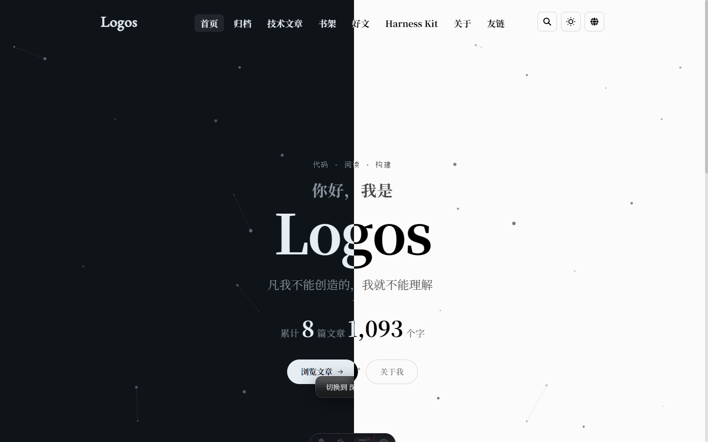

<h1 align="center">Logos</h1>

用 [Momo](https://github.com/Motues/Momo) 进行自定义开发,  最上游仓库： [astro](https://github.com/withastro/astro) ，评论系统部署：[momo-backend](https://github.com/Motues/Momo-Backend)

# 基本功能

简约设计，多端适配，全局搜索，陌生人评论，国际化，图片展示

# 新增特性

* **状态统计**：页脚网站运行时间，首页全局文章数，字数统计
* **AI总结(可配制)** ：文章顶部新增AI总结
* **更好的多端适配**： 各个板块都能在移动端有行号的兼容性
* **全局搜索**
* 除了文章分类，归档，专栏，标签以外，还添加外链收藏，书籍，harness 分享，关于(个人卡片，网站简介)等一些可替换的页面

内容目录、元信息字段与使用示例请查看[内容元信息使用指南](doc/content-metadata.md)。

# 展示图

更多展示图请查看线上网址
